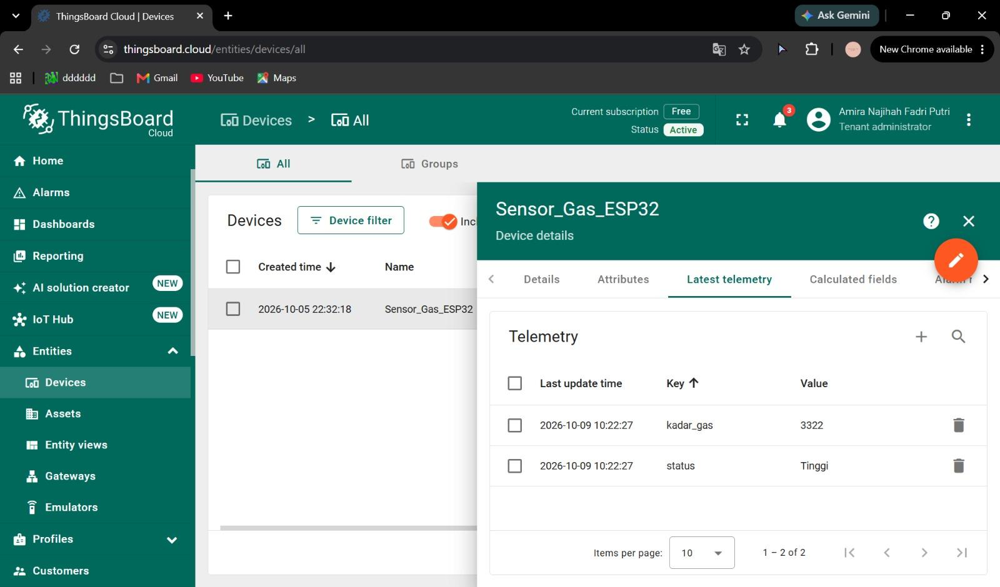

# Gas & Smoke Monitoring (ESP32 + MQ-2 simulation + ThingsBoard Cloud, in Wokwi)

An ESP32 in **Wokwi** reads a potentiometer that stands in for an **MQ-2** gas sensor, lights a green / yellow / red LED depending on the level, and publishes the value to a **ThingsBoard Cloud** dashboard over MQTT. Made for the Internet of Things course (Task 5 demo).

## Components
| Component | Function |
|---|---|
| ESP32 (Wokwi) | Reads the sensor, drives the LEDs, publishes telemetry |
| Potentiometer slider (replaces MQ-2) | Analog gas level, GPIO 34 (0 - 4095) |
| Green / yellow / red LED | Local indicator: Safe / Medium / High (GPIO 25 / 26 / 27) |
| ThingsBoard device + Access Token | Receives MQTT telemetry |
| Chart, Gauge and Alarm widgets | History, latest value, warning |

## Thresholds
| Status | ADC value | LED |
|---|---|---|
| Aman (Safe) | below 750 | Green |
| Sedang (Medium) | 750 - 2499 | Yellow |
| Tinggi (High) | 2500 and above | Red |

> The sketch in the report uses 750 as the lower threshold, but the report's comments and classification table say 500. This repo follows the code (750). Decide which one is correct and make the report and the sketch agree.

## How It Works
1. Connects to `Wokwi-GUEST` Wi-Fi, then to `thingsboard.cloud` (port 1883) using the device Access Token as the MQTT username.
2. Every 5 seconds it reads the ADC, turns all LEDs off, then turns on the one that matches the level.
3. It publishes `{"kadar_gas": <value>, "status": "<Aman|Sedang|Tinggi>"}` to `v1/devices/me/telemetry`.
4. On ThingsBoard, a Timeseries Line Chart, a Gauge (max 4095) and an Alarm widget (rule: `kadar_gas >= 2500`) show the data.

## Code
[`thingsboard_gas_monitor/thingsboard_gas_monitor.ino`](thingsboard_gas_monitor/thingsboard_gas_monitor.ino)

Library: `PubSubClient` (see `thingsboard_gas_monitor/libraries.txt`).

> **Security:** the Access Token is a placeholder. Paste your own device token only locally and never commit it.

## Run It
1. In ThingsBoard create a device and copy its Access Token.
2. In Wokwi build the circuit (potentiometer on GPIO 34, LEDs on 25 / 26 / 27) and paste the sketch.
3. Start the simulation, move the slider and check **Latest telemetry** on the device.

## Possible Improvements
- Add a buzzer and email / Telegram notifications from ThingsBoard alarms.
- Use a physical ESP32 + MQ-2 with calibrated thresholds.
- Add temperature and humidity sensors.

## Authors
Amira Najihah Fadri Putri, Mareta Surya Tananjaya, Novasya Aulia Putri Hidayat, Sulthania Auliya Afandi (Kelompok 3)

## Report
Full report: [`docs/Kel3_DemoTugas5_docx.pdf`](docs/Kel3_DemoTugas5_docx.pdf)

Demo video: https://drive.google.com/file/d/1r2VLC21RihCzSBPC2qYrTCiN6lezUdKy/view?usp=drivesdk
